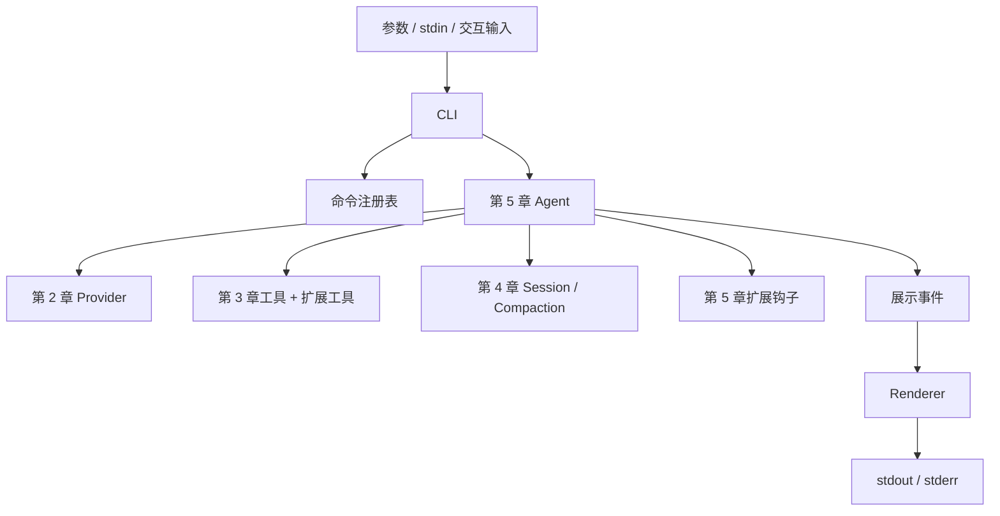

# 第 7 章：CLI 与总结

## 核心概念

第 5 章已经把前面的能力接成一个可扩展的 Agent，但入口还是一个简单的 `input()` 循环。读者可以观察原理，却还不方便用它完成实际任务。

本章解决的是交互边界：任务从哪里来，运行状态显示在哪里，怎样恢复会话，怎样把结果交给其他程序，以及用户中断时如何保留一个可继续使用的状态。

我们复用第 5 章的 Agent，不再复制主循环。CLI 只做参数解析、资源选择、终端显示和退出处理。

| 能力 | 本章实现 |
|---|---|
| 一次性任务 | 位置参数，或者从 stdin 读取任务 |
| 交互输入 | `prompt_toolkit` 历史与斜杠命令补全 |
| 输出展示 | Rich 显示文本、模型步骤、工具状态和压缩信息 |
| 会话恢复 | `-c` 恢复当前项目最近的会话，`--session` 打开指定文件 |
| 流式输出 | 交互模式默认开启；一次性任务可用 `--stream` 开启 |
| 管道输出 | 默认只把最终回答放进 stdout，状态和错误放进 stderr |
| 中断与退出 | Ctrl+C、Ctrl+D、`/quit`，以及明确的进程退出码 |
| 扩展加载 | 复用第 5 章，支持重复使用 `-e` |

这里的终端 UI 是逐行交互界面，没有全屏布局、工具折叠、图片显示或运行中的输入队列。先把一次完整任务的行为做明确，再考虑更复杂的终端渲染。

## 文件结构

```
07-cli/
├── mini-pi                 # 可执行的轻量启动器
├── src/
│   ├── bootstrap.py        # 导入第 5 章核心
│   ├── cli.py              # 参数、会话选择、交互流程
│   ├── ui.py               # Rich 输出与输入编辑器
│   ├── main.py             # Python 入口
│   └── test_cli.py         # 真实子进程和假 Agent 测试
├── requirements.txt
└── README.md
```

运行需要完整教程仓库。`bootstrap.py` 找到相邻的第 5 章；第 5 章再导入第 2～4 章的实现。因此它能从任意工作目录启动，但不能只复制 `mini-pi` 文件到另一台机器就运行。

## 第一部分：CLI 与核心分工



Agent 通过 `notify(event)` 发出展示事件；它不导入 Rich 或 `prompt_toolkit`。同一个 Agent 可以连接终端 Renderer，也可以连接测试中的 `list.append`，未来还可以连接 Web UI。

这与扩展事件有区别：`before_tool_call` 可以改变行为；面向 UI 的 `tool_start`、`text_delta` 等只用于观察。终端渲染不承担是否允许执行工具的决定。

本章仍用同步模型请求和串行工具执行。模型运行时不能在编辑器里继续排队输入；Ctrl+C 通过 Python 中断当前调用，而不是实现第 1 章分析的 steering / follow-up 队列。

## 第二部分：决定运行模式

### 给出任务，就执行一次

```bash
python3 07-cli/src/main.py "读取 README.md，概括项目结构"
```

完成后退出。成功时退出码为 0；API 错误、扩展加载失败或达到最大步数时返回 1。

`--print` 明确表达一次性模式，也允许从 stdin 读取任务：

```bash
printf '%s\n' '读取 README.md，概括项目结构' | python3 07-cli/src/main.py --print
```

CLI 先读完 stdin，拼成一次用户请求，再执行。它不把每一行当成一个独立 turn。空的 stdin 直接正常退出，不创建会话，也不调用模型。

### 没有任务，并连接终端，就进入交互模式

```bash
python3 07-cli/src/main.py
```

`sys.stdin.isatty()` 用来识别输入是否来自终端。自动判断之外，也可以用 `--interactive` 强制交互模式；测试可以通过管道提供 `/help`、`/quit` 等输入。

```bash
python3 07-cli/src/main.py --demo --interactive --plain
```

交互模式遇到一个任务错误后继续接受输入，不让一次网络失败结束整个会话。编辑输入时 Ctrl+C 取消输入；执行任务时 Ctrl+C 中断这一轮；Ctrl+D 或 `/quit` 退出。

`--plain` 只把输入编辑器换成普通 `input()`，关闭历史和补全，方便在受限终端或自动化测试中运行。它不是权限模式，也不会改变工具能力。

## 第三部分：流式文本与完整消息

### 两种数据有不同用途

Provider 返回的流式事件包括：

```python
{"type": "text_delta", "text": "先读取"}
{"type": "text_delta", "text": "项目说明。"}
{"type": "done", "message": complete_message}
```

`text_delta` 用来展示，`done` 中的完整 Message 用来保存和执行。工具参数可能分散在多个增量片段里，不能在看到第一个片段时就执行工具。

第 5 章的 Agent 收集最终消息后才写入会话、检查停止原因并执行调用。只有部分文字、没有 `done` 的响应不会当成完整 assistant 消息保存。

OpenAI 适配器还检查是否收到结束标记；流提前断开时报告错误。消费结束或用户中断后关闭流，释放连接。Anthropic 使用 SDK 的流上下文和最终消息累积能力。

### 为什么流结束后不能再打印一次完整文本？

如果 delta 已经逐段显示，最后再 `print(message.content)` 会把回答重复一遍。

`message_end` 带有 `streamed` 字段。流式模式结束时 Renderer 只补换行；非流式交互模式才显示完整文本。

Renderer 不解释模型文字中的 Rich markup。模型输出 `[red]` 时，它就是普通文字，而不是终端格式控制指令。这里没有做完整的终端控制字符净化，处理不可信外部输出时可以继续扩展这一层。

### 一次性任务默认只输出最终回答

交互时，用户想知道模型正在做什么；管道中，下游程序通常只想得到任务结果。

```bash
python3 07-cli/src/main.py --print "概括 README.md" > summary.txt
```

`summary.txt` 只包含最终回答。会话路径、扩展日志、工具名称、压缩提示和错误放在 stderr，不污染正文。

一次性任务默认使用非流式模型调用。`--stream` 会显式改变这一点，把本轮所有模型文字逐段写入 stdout，包括工具调用前的说明。

`--print` 与 `--stream` 不能同时使用：前者承诺只输出最终回答，后者承诺边生成边显示。参数解析会拒绝这个冲突，而不会默默选择一种行为。

达到步数上限时，不能把最后一条“我还需要继续查看文件”当成最终回答。CLI 返回 1，并在 stderr 说明任务尚未确认完成。

## 第四部分：会话属于哪个项目？

### 默认按工作目录隔离

不同项目可能有相同的目录名称。只用目录名作为存储键，会把两个 `backend/` 的会话混在一起。

本章对当前工作目录的绝对路径计算 SHA-256，取前 12 位作为子目录名：

```
~/.mini-pi/cli-sessions/
└── <工作目录路径哈希>/
    ├── <时间戳>_<会话id>.jsonl
    └── input.history
```

哈希是目录标识，不是加密；JSONL 中的对话和工具输出仍是明文。

`--session-dir` 可以更改存储根目录，它下面仍然按项目隔离。运行多个实例同时写同一个会话文件不在本教程支持范围内。

### 三种会话选择方式

| 参数 | 行为 |
|---|---|
| 无恢复参数 | 在当前项目创建新会话 |
| `-c` / `--continue` | 继续当前项目最近修改的 JSONL，没有时创建新会话 |
| `--session path` | 打开指定文件；不存在时报错，不把拼错的路径创建成新会话 |

`-c` 和 `--session` 互斥。第 4、5 章的会话可以通过 `--session` 明确打开；它们不在第 7 章默认的最近会话目录中。

恢复会话不会恢复文件系统。工具仍在当前工作目录运行，因此恢复其他项目的会话前，应切换到相应项目目录。模型切换由启动参数决定；这个版本不提供交互式 `/model`，也没有完整的跨模型历史修复。

### 输入历史不是模型历史

`input.history` 保存编辑器输入，方便按上下箭头找回命令；JSONL 保存实际对话、工具结果和压缩检查点。

`/help` 不会成为模型消息，但可能出现在输入历史中。不能把编辑器历史直接当成完整对话，也不能把删除输入历史当成删除模型会话。

## 第五部分：中断是一条完整的控制路径

### 中断模型生成

如果请求正在流式生成，已展示的部分文字可能留在终端上，但尚未完成的 assistant 消息不会写进会话。CLI 补上换行并显示中断信息，用户可以继续输入。

这也是为什么不能在每个 delta 到达时直接追加一条 assistant 消息：显示进度和保存协议消息是两个不同的操作。

### 中断工具执行

模型请求的完整工具批次可能已经写入会话。中断后，第 5 章 Agent 为尚未返回的 id 补齐错误结果，提示执行中的工具可能已经产生副作用。

第 3 章 bash 工具在超时或 `KeyboardInterrupt` 时尝试终止进程组，并回收进程。这里使用 `start_new_session` 创建独立进程组；Windows 的清理仍是简化的 terminate / kill，不能保证所有后代进程都被终止。主动脱离进程组的后台程序也可能继续运行。

对 write / edit，中断处理不能提供事务回滚。先检查文件和程序的实际状态，再决定下一步；恢复时不会自动重新执行未完成的工具。

### 错误后仍能继续使用

交互循环在输入边界和任务边界分别处理异常：

```python
# 输入边界
try:
    text = reader()
except EOFError:
    return 0
except KeyboardInterrupt:
    continue

# 任务边界
code, exit_requested = run_turn(agent, text, ...)
```

`run_turn()` 把任务中断转换为 130，把普通异常转换为 1。交互循环处理完这一轮后继续输入；一次性模式直接把这个 code 交给操作系统。

| 退出码 | 含义 |
|---|---|
| 0 | 一次性任务完成，或正常退出交互界面 |
| 1 | 模型/工具循环错误、扩展加载失败、错误命令或最大步数限制 |
| 2 | 命令行参数错误，由 argparse 返回 |
| 130 | 一次性任务被 Ctrl+C 中断 |

单个工具返回错误时，模型仍有机会纠正；只要它继续完成整个任务，进程可以正常退出。本教程的“完成”依据模型不再请求工具，不代表已经独立证明用户目标满足。

## 如何运行

### 安装与离线演示

在仓库根目录执行：

```bash
python3 -m venv .venv
source .venv/bin/activate
pip install -r 07-cli/requirements.txt

# 无需 API key
python3 07-cli/src/main.py --demo "介绍这个项目"

# 交互模式，试试 /project、/tree、/tokens、/help
python3 07-cli/src/main.py --demo --interactive

# 显式查看流式过程
python3 07-cli/src/main.py --demo --stream "介绍这个项目"
```

离线 Provider 只演示固定流程，不理解任意任务。离线压缩返回示例文字，也不应拿来保存需要保真的真实工作会话。

### 连接模型、恢复和扩展

```bash
export OPENAI_API_KEY="your-api-key"
export OPENAI_MODEL="gpt-4o-mini"     # 可选，默认值相同
# export OPENAI_BASE_URL="https://your-compatible-endpoint/v1"

python3 07-cli/src/main.py "读取 README.md，说明每章实现了什么"
python3 07-cli/src/main.py -c
python3 07-cli/src/main.py --session /path/to/session.jsonl

# Anthropic 模型名称由你提供
export ANTHROPIC_API_KEY="your-api-key"
export ANTHROPIC_MODEL="your-model-id"
python3 07-cli/src/main.py --provider anthropic

# 额外加载扩展
python3 07-cli/src/main.py -e /path/to/extension.py

# 不加载附带扩展；显式 -e 指定的文件仍会加载
python3 07-cli/src/main.py --no-extensions -e /path/to/extension.py

# Skill：默认自动扫描项目与用户的 .mini-pi/skills/（存在时），可追加目录
python3 07-cli/src/main.py --skills-dir ./docs-skills "按检查单处理"
python3 07-cli/src/main.py --no-skills   # 全部关闭
```

默认附带扩展包括项目查看、工具日志和 bash 字符串拦截示例。关闭示例扩展不会关闭四个内置工具，也不会改变系统权限。Skill 的机制与示例见[第 6 章](../06-skills/README.md)；加载后可用 `/skill <名字> [请求]` 强制加载某个 Skill。

缩小窗口时同时设置压缩预算：

```bash
python3 07-cli/src/main.py --context-window 20000 --reserve-tokens 8000 --keep-recent-tokens 4000
```

`context-window` 是用户提供的预算，本章不自动查询模型规格。它必须与预留、保留预算一起调整。估算未包含完整协议和工具定义开销，压缩摘要本身也可能超限。

### 从其他目录使用启动器

激活虚拟环境后，把启动器目录加入 PATH：

```bash
export PATH="$PWD/07-cli:$PATH"
mini-pi --demo "介绍当前目录"
```

`mini-pi` 根据自身位置找源码；工具根据启动时的工作目录执行。PATH 只在当前 shell 中生效，不会自动安装或修改系统配置。

### 完整任务示例

连接真实模型后，可以尝试：

```bash
python3 07-cli/src/main.py "在 /tmp/mini-pi-playground/hello.py 创建一个打印 Hello mini-pi 的程序，用 bash 运行它，再用 read 确认内容"
```

这条任务串起 write、bash、read、Provider 和会话存储。退出后用 `-c` 恢复，输入 `/tree` 查看调用历史。再输入 `/compact 保留文件路径和运行结果`，观察模型生成摘要并保留近期消息。

## 对比 pi 的真实实现（TypeScript）

本节固定参考提交 [`8bb180bec133199c913ca8ef9bb30bd9ab12a72b`](https://github.com/earendil-works/pi/tree/8bb180bec133199c913ca8ef9bb30bd9ab12a72b)。

### 1. 交互模式和 print 模式是不同的展示方式

pi 的 [`args.ts`](https://github.com/earendil-works/pi/blob/8bb180bec133199c913ca8ef9bb30bd9ab12a72b/packages/coding-agent/src/cli/args.ts#L173-L188) 解析 `--print` 和扩展路径；[`print-mode.ts`](https://github.com/earendil-works/pi/blob/8bb180bec133199c913ca8ef9bb30bd9ab12a72b/packages/coding-agent/src/modes/print-mode.ts) 在 text 模式输出最终 assistant 文字，在 json 模式订阅并输出事件。

mini-pi 实现了最终文字输出和显式流式输出，没有实现 JSON 事件模式。未来加 `--json` 时，应定义稳定的输出协议，而不是把任意内部对象直接 `json.dumps()` 给下游。

### 2. 同一个核心驱动不同界面

pi 的交互模式订阅会话事件，更新终端组件；print 模式订阅或读取同一会话运行时。mini-pi 则用 `notify` 连接核心和 Renderer，输入与展示层可以被替换。

区别在于 pi 有完整的异步运行时和终端组件系统，本章只有同步循环与逐行输出。两者可以具有相似的边界划分，而不必具有同样的代码规模。

### 3. 快捷键语义不能照搬名称

pi 参考提交的 [`setupKeyHandlers()`](https://github.com/earendil-works/pi/blob/8bb180bec133199c913ca8ef9bb30bd9ab12a72b/packages/coding-agent/src/modes/interactive/interactive-mode.ts#L3068-L3099) 在流式生成时由 Escape 触发中断处理。其 [`handleCtrlC()` 与 `handleCtrlD()`](https://github.com/earendil-works/pi/blob/8bb180bec133199c913ca8ef9bb30bd9ab12a72b/packages/coding-agent/src/modes/interactive/interactive-mode.ts#L4281-L4294) 分别处理清空输入/连续按键退出和退出。

本章采用 Python 常见的 Ctrl+C 中断、Ctrl+D 结束输入，没有复制 pi 的快捷键设置。比较源码时，应比较处理路径，不应因为界面都运行在终端就假设按键含义相同。

## 架构对比：pi、Claude Code、OpenHands

这一节比较公开的接口与设计范围，不推断未公开的内部源码，也不做能力排行榜。pi 使用上述固定提交；Claude Code 和 OpenHands 资料查阅日期为 2026-10-13。

| 维度 | mini-pi | pi | Claude Code | OpenHands Software Agent SDK |
|---|---|---|---|---|
| 本教程关注点 | 可读的 Python 最小实现 | 可扩展的 Agent harness | 围绕模型的工具、上下文与使用流程 | 可组合的 Agent、工具与运行环境 |
| 模型边界 | OpenAI / Anthropic Provider | 独立 AI 包与 Provider 能力 | Claude 模型与 Agent 工具循环 | LLM 与 Agent 核心分层 |
| 扩展边界 | Python 注册工具、命令、钩子与 Skill 加载 | 扩展、skills、模板、主题和包 | hooks、skills、MCP、subagents | SDK 与工具、workspace、agent server 分层 |
| 执行环境 | 当前本机进程，无沙箱 | 通过运行时和扩展组织执行能力 | 本地、云端或远程控制等入口 | 本地或远端 workspace，支持沙箱运行 |
| 本章 UI | 行式 CLI | 交互终端、print 等模式 | 终端及其他界面 | SDK 可嵌入不同应用 |

Claude Code 官方文档把工具循环、上下文管理和执行环境放在模型外围，并描述 hooks、MCP、skills 与 subagents 等扩展能力。参见 [How Claude Code works](https://code.claude.com/docs/en/how-claude-code-works) 和 [Create custom subagents](https://code.claude.com/docs/en/sub-agents)。

OpenHands 的公开架构把系统分为 SDK、tools、workspace 和 agent server，强调可组合的运行边界。参见 [SDK Architecture Overview](https://github.com/OpenHands/docs/blob/main/sdk/arch/overview.mdx) 与 [Design Principles](https://github.com/OpenHands/docs/blob/main/sdk/arch/design.mdx)。

这些项目共享“模型决定下一步，工具提供行动和观察”的基本循环。差异主要累积在核心外围：权限、执行环境、恢复、上下文策略、扩展协议、UI 和运维。

## 设计取舍：为什么从少量工具开始？

mini-pi 选 read、write、edit、bash，是因为它们足以演示观察文件、改变文件和执行程序。每个新增工具都需要模型理解说明、参数 Schema、错误返回和使用时机。

bash 足够通用，但专门的文件工具提供更明确的参数和行为。edit 的唯一匹配检查尤其容易在测试中说明。默认工具少，有助于把这些边界讲清楚；不能据此推断工具越少、实际任务效果就一定越好。

扩展让“增加能力”不必等同于“修改核心”。工具数量增多时，还要继续考虑哪些工具当前激活、哪些延迟发现，以及 Schema 对上下文的影响。pi 参考提交已经有比本教程更丰富的工具暴露机制。

### 为什么没有内置子 Agent？

pi 参考提交的 [项目 README](https://github.com/earendil-works/pi/blob/8bb180bec133199c913ca8ef9bb30bd9ab12a72b/README.md#L15-L19) 把 sub-agents 和 plan mode 列为可以按用户工作流构建或通过包补充的能力。

mini-pi 也暂时不实现子 Agent，但理由首先是教学范围：子 Agent 不只是递归调用一次 `prompt()`。它涉及独立上下文、共享工作区副作用、取消传播、预算、任务回收，以及把结果放回父会话的协议。

第 5 章的扩展接口已经提供试验入口，但没有解决这些运行时问题。可以做一个串行、只读的研究子任务练习，再逐步讨论并行与隔离，而不是在六章的基础系统里同时引入全部复杂度。

## 六章走完，我们到底实现了什么？

| 章节 | 增加的核心概念 | 最终在哪里使用 |
|---|---|---|
| 1 | 工具循环与停止条件 | 第 5 章 Agent 主循环 |
| 2 | Message / ToolCall / Provider、流式响应 | 当前模型调用和摘要请求 |
| 3 | read / write / edit / bash | 统一工具注册表 |
| 4 | JSONL、分支、上下文投影与压缩 | 每轮保存、恢复和预算控制 |
| 5 | 注册工具、命令、生命周期钩子 | 内置与用户扩展 |
| 6 | CLI、输入历史、流式展示与退出行为 | 最终命令行入口 |

仍未实现：可靠的权限系统和沙箱、原子文件编辑与撤销、多进程会话写入、完整 usage / 成本统计、异步工具与输入队列、图像、热重载、MCP、插件分发和子 Agent 调度。

这些不是换一个提示词就能补上的能力。继续学习时，每增加一项都应问：它在哪个边界生效，失败后历史是否仍完整，怎样用确定性的测试验证？

## 测试（无需 API key）

```bash
python3 -m pytest 07-cli/src/test_cli.py -v

# 所有章节在各自的进程中运行
python3 scripts/test.py
```

CLI 测试实际启动子进程，验证 stdout/stderr、退出码、stdin、流式文本不重复、会话恢复、项目隔离、缺少 key、扩展加载失败和步数限制。对交互中断和错误恢复，则注入 reader 与假 Agent，避免自动化测试依赖真实终端按键。

API 调用仍由假 Provider 或假 SDK 对象模拟。这些测试保证本地协议与交互行为，不验证真实服务是否支持某个模型名称、参数或上下文预算。

## 练习

### 练习 1：添加 JSON 事件模式

实现 `--json`，每行输出一个 JSON 事件。至少包含事件类型、会话 id、工具调用 id；给协议加版本号。JSON 模式的 stdout 不出现输入提示、颜色、日志或普通文字。

验证：下游程序逐行 `json.loads()` 能处理一次包含工具调用的完整任务；错误和中断也有明确结束事件。不要把展示时截断的工具预览冒充完整结果。

### 练习 2：添加多行输入

为 `prompt_toolkit` 增加多行编辑与提交键，区分“插入换行”和“提交任务”。保持 `--plain` 与 stdin 一次性任务的行为不变。

验证：粘贴一段多行代码只产生一条 user 消息；Ctrl+C 取消编辑，不写入半条请求；任务执行中的中断仍走已有清理路径。

## 继续阅读

接着阅读[第 8 章：Harness——设计思路、取舍与验证](../08-harness/README.md)，讨论这些实现背后的选择，以及如何判断生成代码与新增机制是否可靠。

先选一个当前实现的边界，回到 pi 固定提交的对应文件阅读，再自己补一项需求。主循环已经足够小；剩下的工程工作，是让它在异常、长任务、多种模型和真实用户输入下保持可解释、可恢复的行为。
